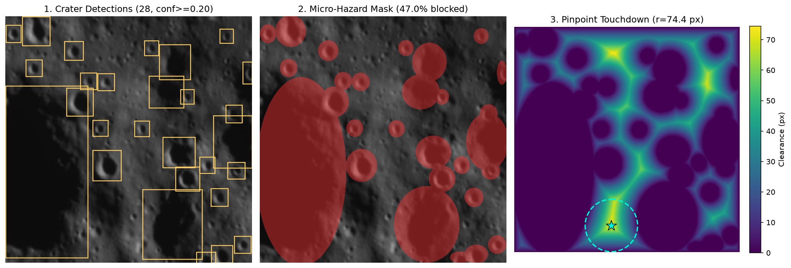
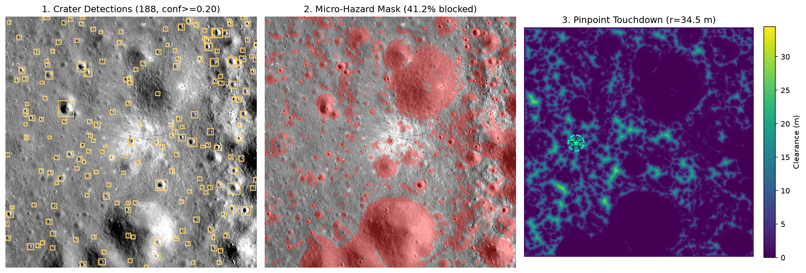

# Lunar Landing Site Selector

[](https://github.com/dermawanw/lunar-landing-site-selector/actions/workflows/ci.yml)

A three-stage **coarse-to-fine** geospatial and computer vision pipeline for lunar landing hazard avoidance:

1. **Phase 1 — Macro Screening (DEM):** Processes NASA LRO LOLA / Kaguya **SLDEM2015** elevation data (~59 m/px) to filter regional slope, surface roughness, and hazard-free clearance radius.
2. **Phase 2 — Micro Hazard Avoidance (CV):** Runs a fine-tuned **YOLO11n** crater detector on top-down lunar optical imagery, rasterizes detections into an elliptical micro-hazard mask, and applies Euclidean Distance Transform (EDT) to select a pinpoint touchdown target.
3. **Phase 3 — Georeferenced NAC + DEM Slope Fusion:** Extracts metric windows from georeferenced **LROC NAC** GeoTIFFs around lunar `(lat, lon)` targets, runs `640×640` tiled YOLO inference with NMS, fuses high-resolution DEM slope hazards onto the NAC pixel grid, and maps the final touchdown point back to lunar coordinates.

---

## Phase 1: Macro Site Selection (SLDEM2015 DEM)


### Methodology
1. **Data Ingestion (`ingest.py`)**: Reads a 2048×2048 px ROI from SLDEM2015 512 ppd (`00N–30N, 000E–045E`), applies the `0.5 m` PDS vertical scale factor, and computes latitude-corrected pixel dimensions (`dx = 52.29 m`, `dy = 59.23 m`).
2. **Terrain Metrics (`terrain_metrics.py`)**:
   - **Slope**: 2D elevation gradient $\theta = \arctan\left(\sqrt{(\partial z/\partial x)^2 + (\partial z/\partial y)^2}\right)$.
   - **Roughness**: Local elevation standard deviation over a 5×5 px sliding window (~260×295 m) via $O(N)$ `uniform_filter`.
3. **Site Selection (`site_selector.py`)**:
   - Masks terrain exceeding `slope <= 5.0°` or `roughness <= 5.0 m`.
   - Computes anisotropic `distance_transform_edt` in meters and FFT disk-averaged zone metrics (`radius < 500 m`) via `scipy.signal.fftconvolve`.
   - Ranks sites with clearance $\ge 500\text{ m}$ (`50%` clearance, `30%` zone-mean slope, `20%` zone-mean roughness) using Greedy NMS (`5 km` separation).

### Results (ROI: 26°–30°N, 0°–4°E)
- **Safe Terrain Coverage**: 46.7% | **Max Clearance**: 1,067 m

| Rank | Latitude (°N) | Longitude (°E) | Score | Clearance (m) | Mean / Max Slope (°) | Mean Roughness (m) | Hazards in 500 m Zone |
|---:|---:|---:|---:|---:|---:|---:|---:|
| #1 | 27.0752 | 1.5049 | 0.820 | 1054 | 1.63 / 4.40 | 1.76 | 0 |
| #2 | 27.3682 | 0.2178 | 0.817 | 1067 | 1.74 / 4.74 | 1.96 | 0 |
| #3 | 26.4053 | 0.8154 | 0.809 | 1029 | 1.50 / 4.18 | 1.67 | 0 |

#### 3D Terrain Inspection (Rank #1)


*(Interactive HTML version generated locally at `outputs/site_rank1_3d.html`.)*

---

## Phase 2: Micro-Crater Detection & Pinpoint Touchdown (YOLO11n + EDT)



### Methodology (`micro_hazard.py`)
- **Model**: `YOLO11n` fine-tuned for 50 epochs (`imgsz=640`, `batch=16`, AMP `fp16`) on an NVIDIA RTX 4060 Laptop GPU.
- **Safety-Biased Thresholding**: Inference defaults to `conf=0.20` to prioritize recall over precision (missing a crater is more hazardous than avoiding a safe patch).
- **Hazard Rasterization & Touchdown**: Detected bounding boxes are expanded by a `1.1×` rim margin into elliptical hazard masks; EDT then selects the pixel with maximum clearance from both crater rims and frame boundaries.
- **CI Isolation**: PyTorch and Ultralytics are isolated under the optional `cv` extra and lazy-imported so CPU-only CI runs stay lightweight.

### Model Evaluation (Lunar Crater Detection 2 v3 — 3,234 Top-Down Images)

| Split | mAP@0.5 | Max Recall (conf=0.00) | 100% Precision Threshold |
|---|---:|---:|---:|
| Validation | **0.767** | 0.95 | conf >= 0.874 |
| Test (held-out) | **0.744** | 0.94 | conf >= 0.857 |

*Sample test-frame output above: 28 craters detected (`conf >= 0.20`), 47.0% frame blocked, pinpoint touchdown at `(564, 275)` with `74.4 px` clearance.*

---

## Phase 3: Georeferenced LROC NAC + DEM Slope Fusion



### Methodology (`nac_georegister.py`, `micro_hazard.py`)
- **Lunar CRS Georegistration**: Supports both geographic and projected metric lunar GeoTIFFs ($R = 1{,}737{,}400\text{ m}$), extracting exact metric windows (`±half_span_m`) around `(lat, lon)` and round-tripping selected touchdown pixels back to lunar `(lat, lon)`.
- **Tiled Sliding-Window Inference**: Splits large high-resolution crops into `640×640` tiles (`128 px` overlap) with single-load model reuse and pure-NumPy IoU NMS (`iou_threshold=0.45`) to preserve micro-crater recall.
- **Multi-Sensor Slope Fusion (`compute_dem_slope_hazard`)**: Reprojects a high-resolution DEM onto the NAC pixel grid (`Resampling.bilinear`, `float64`), computes terrain slope in degrees, and unions `(slope > max_slope_deg) | ~isfinite(slope)` with the optical micro-crater mask before EDT touchdown selection.

### Real-Data Ablation — Apollo 17 Taurus-Littrow (`20.1908°N, 30.7717°E`, `1×1 km` @ `0.50 m/px`)

| Pipeline Configuration | Craters Detected | Blocked Area | Clearance | Touchdown Evaluation |
|---|---:|---:|---:|---|
| Single-pass YOLO11n | 12 | — | 295.0 m | Fails: downscaling `2000×2000` to `640` drops ~93% of micro-craters |
| Tiled YOLO11n (`640×640`, ovl `128`) | 188 | 7.4% | 94.3 m | Blind spot: picks the smooth inner wall of a ~250 m macro-crater |
| **Tiled YOLO11n + NAC DEM 1.5 m (`slope > 5°`)** | **188** | **41.2%** | **34.5 m** | **Macro-crater walls masked; shifts to flat mare (`20.190680°N, 30.762081°E`)** |

*Error analysis:* Optical detection alone catches 5–40 m micro-craters invisible in coarse DEMs but misses >150 m eroded macro-craters that exceed the `640×640` tile scale; conversely, DEM slope masking closes the macro-crater blind spot while relying on YOLO to guard flat plains against micro-craters. Minor artifacts remain: the bright Apollo 17 LM descent stage at frame center triggers a false-positive crater box, and partial detections at tile borders can survive standard IoU NMS (with no effect on touchdown because ellipse union merges overlapping masks).

---

## Quick Start

Requires Python 3.12+ and [`uv`](https://docs.astral.sh/uv/).

```bash
# 1. Install core dependencies & run unit tests (CPU-only, 18 tests)
uv sync
uv run pytest -v

# 2. Run Phase 1 (after placing SLDEM2015_512_00N_30N_000_045.JP2 in data/raw/)
uv run python main.py

# 3. Install optional GPU/CV dependencies for Phase 2 & 3
uv sync --extra cv

# 4. Train YOLO11n on data/craters/data.yaml
uv run --extra cv yolo detect train \
  model=yolo11n.pt data=data/craters/data.yaml epochs=50 imgsz=640 batch=16 patience=15 device=0 name=crater_v1

# 5. Run Phase 2 pinpoint touchdown inference on an optical image
uv run --extra cv python -m lunar_landing_site_selector.micro_hazard <path_to_lunar_image>

# 6. Run Phase 3 georeferenced NAC + tiled YOLO + DEM slope fusion (Apollo 17 1x1 km)
uv run --extra cv python -m lunar_landing_site_selector.nac_georegister \
  data/nac/APOLLO17_ORTHOMOSAIC_50CM.tiff \
  --lat 20.1908 --lon 30.7717 \
  --half-span-m 500 \
  --weights runs/detect/crater_v1/weights/best.pt \
  --tiled \
  --dem data/nac/<apollo17_dem_1.5m.tif> \
  --max-slope 5.0 \
  --out-plot outputs/apollo17_nac_1km_fused.png

# 7. Run integrated Phase 1 -> Phase 3 CLI (with optional NAC GeoTIFF & DEM)
uv run --extra cv python main.py \
  --nac-geotiff <path_to_nac_geotiff> \
  --nac-weights runs/detect/crater_v1/weights/best.pt \
  --nac-dem <path_to_highres_dem>
```

## Limitations & Next Steps

- **Box-to-ellipse approximation**: Axis-aligned bounding boxes rasterized as ellipses can leave minor unmasked shadow slivers on heavily clipped craters at image borders; switching to pixel-level semantic segmentation would tighten rim boundaries.
- **Optical domain edge cases**: High-albedo artificial reflectors (e.g., Apollo 17 LM descent stage) can trigger false positives, and standard IoU NMS does not suppress partial boxes strictly contained inside a full detection across tile borders (containment/IoMin suppression would clean up counts).
- **Scale flag in integrated CLI**: `main.py --nac-dem` assumes elevation values are already in meters (`dem_scale=1.0`); use `nac_georegister --dem-scale` when fusing non-meter DEMs.
- **Illumination & Earth visibility**: Solar elevation and communication line-of-sight are not yet modeled.

## Data Credits

- **Macro DEM**: NASA LRO LOLA / Kaguya SLDEM2015 (`512 ppd` tile).
- **Micro Crater Dataset**: *Lunar Crater Detection 2 (v3)* by Chandrayaan-2 workspace on Roboflow Universe, licensed under **CC BY 4.0**.
- **Phase 3 Validation Imagery & High-Res DEM**: USGS Astrogeology Astropedia — Apollo 17 LROC NAC Orthomosaic (`0.5 m/px`) and LROC NAC DEM (`1.5 m/px`).
