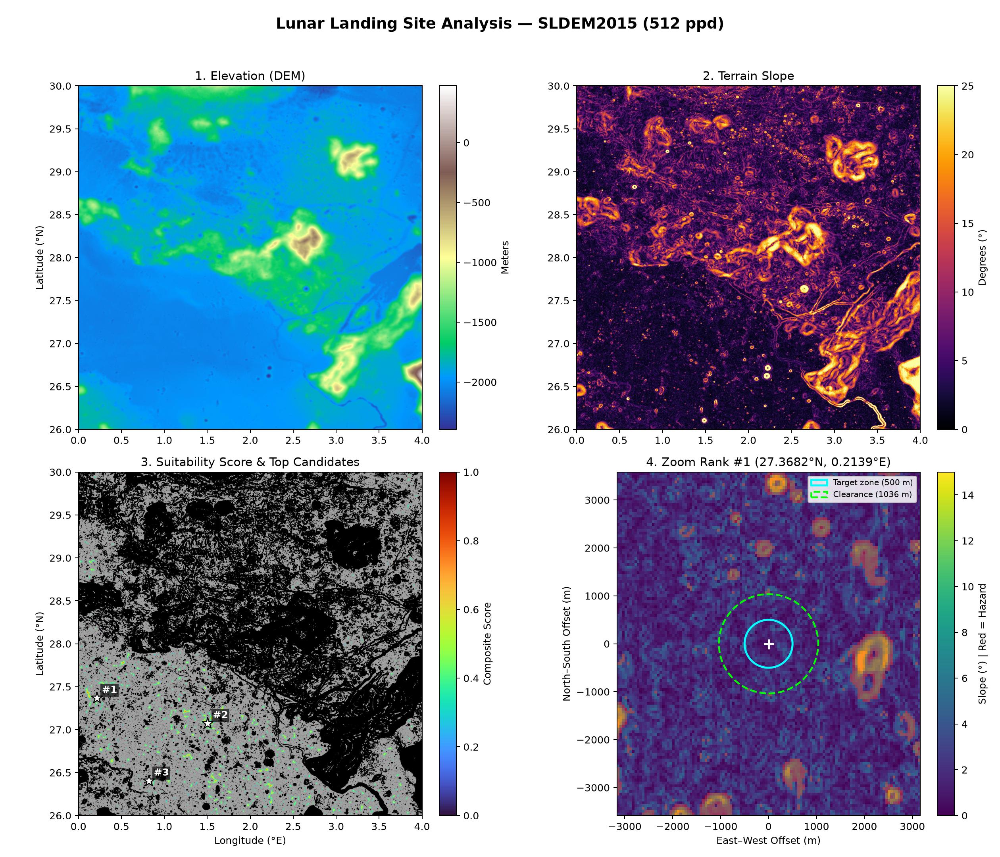

# Lunar Landing Site Selector

[](https://github.com/dermawanw/lunar-landing-site-selector/actions/workflows/ci.yml)

A two-stage **coarse-to-fine** geospatial and computer vision pipeline for lunar landing hazard avoidance:

1. **Phase 1 — Macro Screening (DEM):** Processes NASA LRO LOLA / Kaguya **SLDEM2015** elevation data (~59 m/px) to filter regional slope, surface roughness, and hazard-free clearance radius.
2. **Phase 2 — Micro Hazard Avoidance (CV):** Runs a fine-tuned **YOLO11n** crater detector on top-down lunar optical imagery, rasterizes detections into an elliptical micro-hazard mask, and applies Euclidean Distance Transform (EDT) to select a pinpoint touchdown target.

---

## Phase 1: Macro Site Selection (SLDEM2015 DEM)



### Methodology
1. **Data Ingestion (`ingest.py`)**: Reads a 2048×2048 px ROI from SLDEM2015 512 ppd (`00N–30N, 000E–045E`), applies the `0.5 m` PDS vertical scale factor, and computes latitude-corrected pixel dimensions (`dx = 52.29 m`, `dy = 59.23 m`).
2. **Terrain Metrics (`terrain_metrics.py`)**:
   - **Slope**: 2D elevation gradient $\theta = \arctan\left(\sqrt{(\partial z/\partial x)^2 + (\partial z/\partial y)^2}\right)$.
   - **Roughness**: Local elevation standard deviation over a 5×5 px sliding window (~260×295 m) via $O(N)$ `uniform_filter`.
3. **Site Selection (`site_selector.py`)**:
   - Masks terrain exceeding `slope <= 5.0°` or `roughness <= 5.0 m`.
   - Computes anisotropic `distance_transform_edt` in meters and FFT disk-averaged zone metrics (`radius < 500 m`) via `scipy.signal.fftconvolve`.
   - Ranks sites with clearance $\ge 500\text{ m}$ (`50%` clearance, `30%` zone-mean slope, `20%` zone-mean roughness) using Greedy NMS (`5 km` separation).

### Results (ROI: 26°–30°N, 0°–4°E)
- **Safe Terrain Coverage**: 46.7% | **Max Clearance**: 1,067 m

| Rank | Latitude (°N) | Longitude (°E) | Score | Clearance (m) | Mean / Max Slope (°) | Mean Roughness (m) | Hazards in 500 m Zone |
|---:|---:|---:|---:|---:|---:|---:|---:|
| #1 | 27.0752 | 1.5049 | 0.820 | 1054 | 1.63 / 4.40 | 1.76 | 0 |
| #2 | 27.3682 | 0.2178 | 0.817 | 1067 | 1.74 / 4.74 | 1.96 | 0 |
| #3 | 26.4053 | 0.8154 | 0.809 | 1029 | 1.50 / 4.18 | 1.67 | 0 |

#### 3D Terrain Inspection (Rank #1)


*(Interactive HTML version generated locally at `outputs/site_rank1_3d.html`.)*

---

## Phase 2: Micro-Crater Detection & Pinpoint Touchdown (YOLO11n + EDT)


### Methodology (`micro_hazard.py`)
- **Model**: `YOLO11n` fine-tuned for 50 epochs (`imgsz=640`, `batch=16`, AMP `fp16`) on an NVIDIA RTX 4060 Laptop GPU.
- **Safety-Biased Thresholding**: Inference defaults to `conf=0.20` to prioritize recall over precision (missing a crater is more hazardous than avoiding a safe patch).
- **Hazard Rasterization & Touchdown**: Detected bounding boxes are expanded by a `1.1×` rim margin into elliptical hazard masks; EDT then selects the pixel with maximum clearance from both crater rims and frame boundaries.
- **CI Isolation**: PyTorch and Ultralytics are isolated under the optional `cv` extra and lazy-imported so CPU-only CI runs stay lightweight.

### Model Evaluation (Lunar Crater Detection 2 v3 — 3,234 Top-Down Images)

| Split | mAP@0.5 | Max Recall (conf=0.00) | 100% Precision Threshold |
|---|---:|---:|---:|
| Validation | **0.767** | 0.95 | conf >= 0.874 |
| Test (held-out) | **0.744** | 0.94 | conf >= 0.857 |

*Sample test-frame output above: 28 craters detected (`conf >= 0.20`), 47.0% frame blocked, pinpoint touchdown at `(564, 275)` with `74.4 px` clearance.*

---

## Quick Start

Requires Python 3.12+ and [`uv`](https://docs.astral.sh/uv/).

```bash
# 1. Install core dependencies & run unit tests (CPU-only)
uv sync
uv run pytest -v

# 2. Run Phase 1 (after placing SLDEM2015_512_00N_30N_000_045.JP2 in data/raw/)
uv run python main.py

# 3. Install optional GPU/CV dependencies for Phase 2
uv sync --extra cv

# 4. Train YOLO11n on data/craters/data.yaml
uv run --extra cv yolo detect train \
  model=yolo11n.pt data=data/craters/data.yaml epochs=50 imgsz=640 batch=16 patience=15 device=0 name=crater_v1

# 5. Run Phase 2 pinpoint touchdown inference
uv run --extra cv python -m lunar_landing_site_selector.micro_hazard <path_to_lunar_image>
```

## Limitations & Next Steps

- **Box-to-ellipse approximation**: Axis-aligned bounding boxes rasterized as ellipses can leave minor unmasked shadow slivers on heavily clipped craters at image borders; switching to pixel-level semantic segmentation would tighten rim boundaries.
- **Spatial registration**: Current Phase 2 optical test images lack embedded GeoTIFF georeferencing, so clearance is reported in pixels unless `--meters-per-px` is supplied. Co-registering LROC NAC GeoTIFF strips directly onto Phase 1 `(lat, lon)` candidates is the next integration step.
- **Illumination & Earth visibility**: Solar elevation and communication line-of-sight are not yet modeled.

## Data Credits

- **Macro DEM**: NASA LRO LOLA / Kaguya SLDEM2015 (`512 ppd` tile).
- **Micro Crater Dataset**: *Lunar Crater Detection 2 (v3)* by Chandrayaan-2 workspace on Roboflow Universe, licensed under **CC BY 4.0**.
