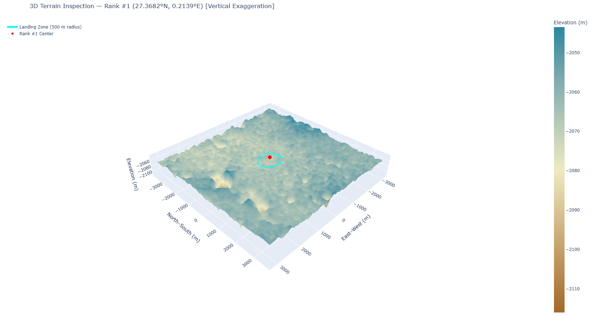

# Lunar Landing Site Selector

A geospatial pipeline that processes NASA LRO LOLA / Kaguya **SLDEM2015** elevation data to identify safe lunar landing zones based on physical terrain constraints (slope, surface roughness, and hazard-free clearance radius).


## Methodology

1. **Data Ingestion (`ingest.py`)**: Reads a 2048×2048 pixel ROI from SLDEM2015 512 ppd (`00N–30N, 000E–045E`), applies the `0.5 m` vertical scaling factor from PDS auxiliary metadata, and computes latitude-corrected pixel dimensions (`dx = 52.29 m`, `dy = 59.23 m`).
2. **Terrain Metrics (`terrain_metrics.py`)**:
   - **Slope**: Computed via 2D elevation gradients: $\theta = \arctan\left(\sqrt{(\partial z/\partial x)^2 + (\partial z/\partial y)^2}\right)$.
   - **Roughness**: Local elevation standard deviation over a 5×5 pixel sliding window (~260×295 m) using an $O(N)$ `uniform_filter` variance formulation.
3. **Site Selection (`site_selector.py`)**:
   - Applies hard constraints (`slope <= 5.0°`, `roughness <= 5.0 m`) to generate a binary safety mask.
   - Computes anisotropic Euclidean Distance Transform (`distance_transform_edt`) in meters to find the exact clearance radius to the nearest hazard.
   - Computes disk-averaged slope and roughness across the entire landing zone (`radius < 500 m`) via 2D FFT convolution (`scipy.signal.fftconvolve`).
   - Ranks candidates with clearance $\ge 500\text{ m}$ using a weighted composite score (`50%` clearance, `30%` zone-mean slope, `20%` zone-mean roughness) and Greedy Non-Maximum Suppression (`5 km` minimum separation).

## Results (ROI: 26°–30°N, 0°–4°E)

- **Safe Terrain Coverage**: 46.7%
- **Maximum Hazard-Free Clearance**: 1,067 m

| Rank | Latitude (°N) | Longitude (°E) | Score | Clearance (m) | Mean / Max Slope (°) | Mean Roughness (m) | Hazards in 500 m Zone |
|---:|---:|---:|---:|---:|---:|---:|---:|
| #1 | 27.0752 | 1.5049 | 0.820 | 1054 | 1.63 / 4.40 | 1.76 | 0 |
| #2 | 27.3682 | 0.2178 | 0.817 | 1067 | 1.74 / 4.74 | 1.96 | 0 |
| #3 | 26.4053 | 0.8154 | 0.809 | 1029 | 1.50 / 4.18 | 1.67 | 0 |

### 3D Terrain Inspection (Rank #1)



*(Interactive HTML version generated locally at `outputs/site_rank1_3d.html`.)*

## Quick Start

Requires Python 3.12+ and [`uv`](https://docs.astral.sh/uv/).

```bash
# 1. Install dependencies
uv sync

# 2. Run unit tests (synthetic terrain verification)
uv run pytest -v

# 3. Download SLDEM2015 tile into data/raw/
BASE_URL="[http://imbrium.mit.edu/DATA/SLDEM2015/TILES/JP2](http://imbrium.mit.edu/DATA/SLDEM2015/TILES/JP2)"
mkdir -p data/raw
curl -L "$BASE_URL/SLDEM2015_512_00N_30N_000_045.JP2" -o data/raw/SLDEM2015_512_00N_30N_000_045.JP2

# 4. Run the full pipeline
uv run python main.py
```

## Limitations & Planned Improvements

- **Resolution ceiling**: SLDEM2015 (~59 m/px) cannot resolve meter-scale boulders or micro-craters. Integrating high-resolution LROC NAC optical imagery with a CV hazard detector is the logical Phase 2 extension.
- **Illumination & Earth visibility**: Solar elevation and communication line-of-sight are not yet modeled (critical for lunar South Pole missions).
